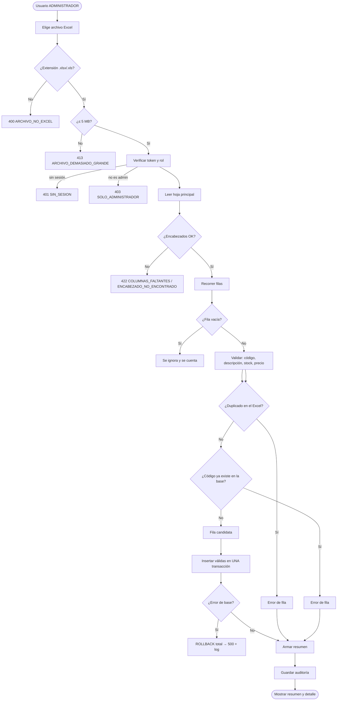
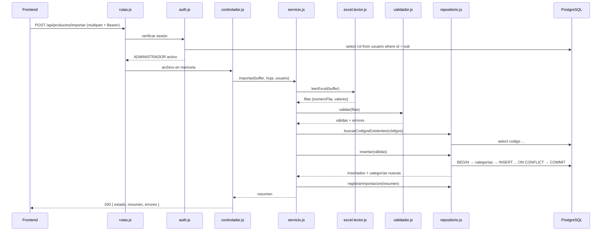

# Importar productos desde Excel

Funcionalidad completa para que un **ADMINISTRADOR** suba una planilla Excel y cada fila se
convierta en un producto de la base de stock, con validación previa, resumen del proceso y
detalle de los errores.

> **Qué se agregó y qué no se tocó.**
> No se cambió ninguna regla de negocio existente: ni RLS, ni `registrar_movimiento`, ni la
> forma de crear productos. La importación **usa** esas reglas. `src/server.js` solo sumó el
> montaje de las rutas y el manejo central de errores; el endpoint `/api/health` sigue igual.
> Todo lo demás son archivos nuevos, una migración aditiva y documentación.

| | |
|---|---|
| **Ramas / archivos nuevos** | ver [Clases involucradas](#3-clases-involucradas) |
| **Migración** | `supabase/migrations/20261111120000_importacion_productos.sql` (solo agrega 2 tablas) |
| **Endpoint** | `POST /api/productos/importar` |
| **Pruebas** | 65 automáticas (`npm test`), incluidas 8 contra PostgreSQL real |
| **Ejemplos listos** | [`ejemplos/productos-ejemplo.xlsx`](ejemplos/productos-ejemplo.xlsx) y [`ejemplos/productos-con-errores.xlsx`](ejemplos/productos-con-errores.xlsx) |

---

## Índice

1. [Análisis de la arquitectura existente](#1-análisis-de-la-arquitectura-existente)
2. [Modelo de datos](#2-modelo-de-datos)
3. [Clases involucradas](#3-clases-involucradas)
4. [Casos de uso](#4-casos-de-uso)
5. [Diagrama de flujo](#5-diagrama-de-flujo)
6. [Diseño de la interfaz](#6-diseño-de-la-interfaz)
7. [API](#7-api)
8. [Puesta en marcha](#8-puesta-en-marcha)
9. [Explicación paso a paso](#9-explicación-paso-a-paso)
10. [Validaciones y mensajes](#10-validaciones-y-mensajes)
11. [Pruebas](#11-pruebas)
12. [Logs y auditoría](#12-logs-y-auditoría)
13. [Decisiones de diseño y límites](#13-decisiones-de-diseño-y-límites)

---

## 1. Análisis de la arquitectura existente

Antes de escribir código se revisó el proyecto tal como está hoy.

### Lo que ya existía

| Pieza | Estado | Consecuencia para la importación |
|---|---|---|
| `src/server.js` | Express con un solo endpoint (`/api/health`), `cors()` y `express.json()` | No había capas ni manejo de errores: se agregaron **sin reemplazar** lo existente |
| Base de datos | PostgreSQL en Supabase, migraciones en `supabase/migrations` | La importación entra por `pg` (`DATABASE_URL`), no por PostgREST: hay que revalidar el rol en el servidor |
| `producto` | `codigo` UNIQUE/NOT NULL, `nombre` NOT NULL, `precio_venta >= 0`, `stock_actual >= 0`, `id_categoria` nullable | El mapeo del Excel tiene que respetar nombres y límites reales (`varchar(50)`, `varchar(150)`, `numeric(12,2)`, `integer`) |
| Stock | `stock_actual` **no se puede editar a mano**; se carga al crear el producto y después solo cambia por movimiento | La importación carga el stock **inicial** en el `INSERT`, igual que la app al crear un producto. No genera movimientos |
| Roles | RLS: crear productos = solo **ADMINISTRADOR** activo | El endpoint exige token de Supabase + rol `ADMINISTRADOR` activo |
| `categoria` | `nombre` UNIQUE | La categoría del Excel se resuelve por nombre (sin distinguir mayúsculas) o se crea |
| Front (`gestor-stock-client`) | React 19 + Tailwind 4 + `lucide-react`, sidebar blanco (`#434655`, hover `#dce9ff`) | La interfaz propuesta sigue esa estética (ver [sección 6](#6-diseño-de-la-interfaz)) |

### Decisiones de integración

1. **Arquitectura en capas** dentro de un módulo por funcionalidad (`src/modules/productos/importacion/`).
   No se creó un “segundo backend”: se sigue el mismo `type: module` y Express.
2. **Lectura ≠ validación ≠ persistencia.** Cada capa tiene una sola responsabilidad y se puede
   probar sola (por eso hay 65 pruebas sin base de datos y 8 con PostgreSQL).
3. **Transacción única** para los productos válidos. Si la base falla a mitad de camino, no queda
   media planilla cargada.
4. **El Excel no entra a la base tal cual:** primero se valida todo, después se inserta solo lo válido.
5. **Sin dependencias nuevas innecesarias:** `multer` (subida), `xlsx` (lectura) y `jose` (validar
   el token de Supabase). Logger propio, sin librerías.

---

## 2. Modelo de datos

### 2.1 Mapeo Excel → `producto`

La planilla esperada:

| Codigo | Descripcion | Categoria | Stock | Precio |
|---|---|---|---|---|
| P001 | Teclado Logitech | Perifericos | 25 | 15000 |
| P002 | Mouse Genius | Perifericos | 40 | 8500 |

Contra la tabla real (que no se modifica):

| Columna Excel | Campo en `producto` | Regla |
|---|---|---|
| `Codigo` | `codigo` | Obligatorio, único, ≤ 50 caracteres |
| `Descripcion` | `nombre` | Obligatorio, ≤ 150 caracteres. Es el nombre que se ve en la app |
| `Categoria` | `id_categoria` | Opcional. Se busca por nombre; si no existe, se crea |
| `Stock` | `stock_actual` | Entero ≥ 0. Es el **stock inicial** |
| `Precio` | `precio_venta` | Número > 0, 2 decimales |
| — | `precio_costo` | 0, salvo que la planilla traiga una columna `Costo` |
| — | `stock_minimo`, `stock_maximo` | 0 (la app los edita después) |
| — | `activo` | `true` |
| — | `fecha_alta` | `now()` por defecto |

**¿Por qué `Descripcion` va a `nombre`?** Porque en el modelo real `nombre` es el campo obligatorio
y `descripcion` es opcional. Si la planilla trae además una columna `Detalle` (o `Observaciones`,
`Notas`), ese texto sí se guarda en `producto.descripcion`.

### 2.2 Columnas aceptadas (alias)

Se normalizan sin acentos, sin mayúsculas y sin signos. La primera coincidencia gana:

| Campo | Alias aceptados |
|---|---|
| Código | `codigo`, `cod`, `cod producto`, `codigo producto`, `sku`, `cod articulo`, `codigo articulo` |
| Descripción | `nombre`, `descripcion`, `producto`, `nombre producto`, `descripcion producto`, `denominacion` |
| Detalle (opcional) | `detalle`, `descripcion larga`, `descripcion detallada`, `observaciones`, `notas` |
| Categoría | `categoria`, `rubro`, `familia`, `grupo` |
| Stock | `stock`, `stock actual`, `cantidad`, `existencias`, `existencia`, `unidades`, `stock disponible` |
| Precio | `precio`, `precio venta`, `precio de venta`, `pvp`, `precio publico`, `precio unitario`, `importe` |
| Costo (opcional) | `costo`, `precio costo`, `precio de costo`, `precio compra`, `costo de compra`, `costo unitario` |

La fila de encabezados se busca en las **primeras 15 filas**, así que se toleran títulos arriba.

### 2.3 Tablas nuevas (migración aditiva)

`supabase/migrations/20261111120000_importacion_productos.sql` crea dos tablas para el historial.
**No modifica** `producto`, `categoria`, `usuario` ni sus permisos.

```sql
importacion_producto
  id_importacion         bigint identity PK
  fecha                  timestamptz  default now()
  id_usuario             uuid FK usuario (on delete set null)
  archivo                text
  hoja                   text
  tamano_bytes           bigint
  filas_procesadas       integer   -- filas con datos (sin contar vacías)
  filas_vacias           integer
  productos_importados   integer
  filas_con_error        integer
  errores_encontrados    integer
  estado                 text check: COMPLETADA | COMPLETADA_CON_ERRORES | RECHAZADA | FALLIDA
  duracion_ms            integer
  detalle                jsonb     -- hojas, fila del encabezado, categorías nuevas…

importacion_producto_error
  id_error        bigint identity PK
  id_importacion  bigint FK importacion_producto (on delete cascade)
  numero_fila     integer
  codigo          text
  mensaje         text
```

RLS: el **ADMINISTRADOR** puede leer; nadie puede escribir desde el front (no hay policy de
`insert`). El servidor escribe con la cadena de conexión de PostgreSQL.

> La importación funciona aunque esta migración todavía no esté aplicada: la auditoría es
> *best effort* y se saltea con un aviso en el log.

---

## 3. Clases involucradas

### 3.1 Estructura real del código

```
src/
├── config/
│   ├── env.js                     Configuración validada (una sola lectura de process.env)
│   └── database.js                Pool de pg + conTransaccion() + consultar()
├── lib/
│   ├── async-handler.js           Envuelve controladores async
│   ├── errors.js                  AppError y derivados con estado HTTP y código estable
│   ├── logger.js                  JSON por línea a consola y archivos
│   └── supabase-jwt.js            Verifica el access token (JWKS o HS256)
├── middleware/
│   ├── auth.js                    requiereAdministrador (rol leído de la tabla usuario)
│   ├── error-handler.js           Formato único de error + traducción de pg/multer
│   ├── request-id.js              X-Request-Id para cruzar respuesta y log
│   └── upload.js                  multer en memoria, .xlsx/.xls, límites
├── modules/productos/importacion/
│   ├── constantes.js              Columnas, alias, límites, estados
│   ├── textos.js                  Normalización (acentos, espacios invisibles, claves)
│   ├── numeros.js                 Números locales: 15.000 / 1.500,50 / $…
│   ├── excel.lector.js            Buffer → filas crudas + número de fila real
│   ├── validador.js               Fila → datos válidos | lista de errores
│   ├── repositorio.js             Único que habla SQL; transacción + auditoría
│   ├── servicio.js                Orquesta leer → validar → chequear → guardar → resumen
│   ├── controlador.js             HTTP ↔ servicio
│   ├── plantilla.js               Genera la plantilla .xlsx al vuelo
│   └── rutas.js                   Router de /api/productos/importar
└── server.js                      (sin cambios de lógica: monta las rutas)

test/
├── numeros.test.js  textos.test.js  validador.test.js  excel-lector.test.js
├── servicio.test.js  http-importar.test.js
└── sql/importacion-sql.test.js    PostgreSQL real (PGlite) + esquema-base.sql
```

### 3.2 Responsabilidades

| Clase / archivo | Responsabilidad | Qué NO hace |
|---|---|---|
| `config/env.js` | Leer y validar variables de entorno una vez | No abre conexiones |
| `config/database.js` | Pool, consultas y transacciones | No conoce productos |
| `lib/logger.js` | Logs JSON a `logs/app-*.log`, `logs/errores-*.log`, `logs/importaciones-*.log` | No corta la petición si falla el disco |
| `lib/supabase-jwt.js` | Verificar firma/vigencia del token | No decide el rol |
| `middleware/auth.js` | Exigir ADMINISTRADOR activo | No parsea el Excel |
| `middleware/upload.js` | Recibir el archivo en memoria, validar extensión/tamaño | No lee el contenido |
| `excel.lector.js` | Excel → filas `{ numeroFila, valores }` | No valida reglas de negocio |
| `validador.js` | Reglas por fila + duplicados del archivo | No accede a la base |
| `repositorio.js` | Códigos existentes, categorías, `INSERT` en transacción, auditoría | No decide qué fila es válida |
| `servicio.js` | Orquestar y armar el resumen | No sabe de HTTP |
| `controlador.js` | Traducir HTTP ↔ servicio | No tiene SQL |
| `rutas.js` | Definir endpoints y middlewares | No tiene lógica |

### 3.3 Dependencias (de afuera hacia adentro)

```
rutas.js
  └── auth.js ──────────────► supabase-jwt.js ──► config
  └── upload.js
  └── controlador.js
        └── servicio.js
              ├── excel.lector.js ──► constantes / textos / numeros
              ├── validador.js ─────► constantes / textos / numeros
              └── repositorio.js ───► config/database.js ──► pg
                        └── auditoría (best effort)
todas ──► lib/errors.js, lib/logger.js
```

El flujo va en una sola dirección: las capas de abajo no conocen a las de arriba.

---

## 4. Casos de uso

Actor principal: **ADMINISTRADOR** autenticado.

### CU-01 · Importar productos desde una planilla válida

| | |
|---|---|
| **Precondición** | Sesión iniciada con rol ADMINISTRADOR activo. Planilla con las columnas obligatorias |
| **Disparador** | El usuario elige “Importar desde Excel”, selecciona el archivo y confirma |
| **Flujo principal** | 1. Se valida el token y el rol. 2. Se recibe el archivo (≤ 5 MB, `.xlsx`/`.xls`). 3. Se lee la hoja principal. 4. Se validan las filas. 5. Se descartan las vacías. 6. Se insertan las válidas en una transacción. 7. Se muestra el resumen: procesados, importados, con error y el detalle |
| **Postcondición** | Productos creados con su stock inicial, `activo = true`, categoría asignada. Resumen guardado en la auditoría y en el log |

### CU-02 · Importar una planilla con filas inválidas

Igual que CU-01, pero las filas con error **no** se importan. El resumen indica cuántas se
procesaron, cuántas entraron y el detalle por fila (`fila 3 — P002 — El precio tiene que ser
mayor que cero`). Estado: `COMPLETADA_CON_ERRORES`.

### CU-03 · Detectar un código repetido en el mismo Excel

La **primera** aparición se considera la válida; las siguientes se rechazan con
`El código "P005" está repetido en el archivo (ya aparece en la fila 7)`.

### CU-04 · Rechazar códigos que ya existen en el sistema

Si el código ya está en `producto`, la fila no se importa: `El código "P001" ya existe en el
sistema`. La comparación no distingue mayúsculas (`p001` = `P001`).

### CU-05 · Descargar la plantilla

`GET /api/productos/importar/plantilla` devuelve un `.xlsx` con las columnas correctas, dos filas
de ejemplo y una hoja de instrucciones.

### CU-06 · Consultar el historial

`GET /api/productos/importar/historial` devuelve las últimas importaciones con su resumen y autor.

### CU-07 · Cancelar o corregir

Si el archivo no es Excel, supera el tamaño, no tiene encabezados o le faltan columnas, **no se
escribe nada** y se responde con un mensaje que dice qué corregir.

### Errores contemplados

| Situación | Resultado |
|---|---|
| Sin sesión / token vencido | 401, no se procesa el archivo |
| EMPLEADO o usuario inactivo | 403 |
| Archivo `.txt`, `.csv` o corrupto | 400 u 422 |
| Archivo > 5 MB | 413 |
| Faltan columnas | 422 con la lista de columnas faltantes |
| Más de 2.000 filas | 422 |
| Se cae la base a mitad de la inserción | `ROLLBACK`, no queda nada y se registra `FALLIDA` |

---

## 5. Diagrama de flujo



**Secuencia (con las capas):**



---

## 6. Diseño de la interfaz

Se propone una pantalla dentro de **Inventario → Productos → “Importar desde Excel”**, respetando
la estética del front actual (tarjetas blancas, texto `#434655`, acento `#dce9ff`, iconos
`lucide-react`).

### 6.1 Wireframe

```
┌──────────────────────────────────────────────────────────────────────────┐
│  ← Productos                Importar productos desde Excel               │
│                             Cargá la planilla y revisá el resultado       │
├──────────────────────────────────────────────────────────────────────────┤
│                                                                          │
│  ┌────────────────────────────────────────────────────────────────────┐  │
│  │                              ⬆                                     │  │
│  │              Arrastrá tu planilla acá o elegí un archivo            │  │
│  │                     .xlsx o .xls · hasta 5 MB                       │  │
│  │                                                                    │  │
│  │        [ Elegir archivo ]        [ Descargar plantilla ]           │  │
│  │                                                                    │  │
│  │        Última importación: hoy 14:32 · 2 productos · 7 errores      │  │
│  └────────────────────────────────────────────────────────────────────┘  │
│                                                                          │
│  ┌──────────────────────┐ ┌──────────────────────┐ ┌──────────────────┐  │
│  │  📄  9               │ │  ✅  2               │ │  ⚠️  7           │  │
│  │  Registros procesados│ │  Productos importados│ │  Con error       │  │
│  └──────────────────────┘ └──────────────────────┘ └──────────────────┘  │
│                                                                          │
│  ┌────────────────────────────────────────────────────────────────────┐  │
│  │  Detalle de errores                              [Filtro: todas ▾] │  │
│  ├──────┬────────┬───────────────────────────────────────────────────┤  │
│  │ Fila │ Código │ Problema                                          │  │
│  ├──────┼────────┼───────────────────────────────────────────────────┤  │
│  │  3   │ P002   │ El stock no puede ser negativo.                   │  │
│  │  4   │ P003   │ El precio tiene que ser mayor que cero.           │  │
│  │  8   │ P005   │ El código "P005" está repetido (fila 7).          │  │
│  └──────┴────────┴───────────────────────────────────────────────────┘  │
│                                                                          │
│         [ Volver a importar ]                    [ Ver productos ]       │
└──────────────────────────────────────────────────────────────────────────┘
```

### 6.2 Estados de la pantalla

| Estado | Qué ve el usuario |
|---|---|
| **Inicial** | Zona de arrastre + botón “Descargar plantilla” + requisitos |
| **Archivo elegido** | Nombre, tamaño, botón “Importar” habilitado, “Cambiar archivo” |
| **Procesando** | Barra/spinner y texto “Leyendo la planilla…”, botones deshabilitados |
| **Resultado OK** | Tres tarjetas (procesados / importados / con error) y mensaje “Se importaron N productos” |
| **Resultado con errores** | Las tres tarjetas + tabla de errores por fila, descargable/exportable |
| **Todo rechazado** | Aviso en rojo con el motivo y el botón “Volver a importar” |
| **Error de archivo** | Mensaje del backend (por ejemplo, “Falta la columna Precio”) |

Reglas de UX que conviene respetar:

- El botón de importar se deshabilita mientras se procesa (evita el doble envío).
- Los mensajes de error se muestran **tal como los manda el backend**, ya están en español.
- Si el resumen trae `estado: "RECHAZADA"`, no mostrar “listo”: mostrar “no se importó ningún producto”.
- Después de importar, refrescar la lista de productos y los KPIs.

### 6.3 Componente React de referencia

En [`ImportarProductos.jsx`](ImportarProductos.jsx) hay una implementación completa lista para
copiar al front (`gestor-stock-client`), con drag & drop, estados y tabla de errores.
Solo necesita dos datos del proyecto: la URL del backend (`VITE_API_URL`) y el token de la sesión
de Supabase, que se pasa por prop.

```jsx
<ImportarProductos token={session.access_token} onImportado={refrescarProductos} />
```

---

## 7. API

Base: `http://localhost:4000` (o la URL del servidor desplegado).

### `POST /api/productos/importar`

`Content-Type: multipart/form-data` · `Authorization: Bearer <access_token de Supabase>`

| Campo | Tipo | Obligatorio | Descripción |
|---|---|---|---|
| `archivo` | file | sí | `.xlsx` o `.xls`, hasta `IMPORT_MAX_MB` (5 MB) |
| `hoja` | text | no | Nombre de la hoja; por defecto, la primera |

**Respuesta 200** (se procesó, aunque no se haya importado nada):

```json
{
  "ok": true,
  "estado": "COMPLETADA_CON_ERRORES",
  "idImportacion": 12,
  "archivo": {
    "nombre": "productos.xlsx",
    "tamanoBytes": 9567,
    "hoja": "Productos",
    "hojas": ["Productos"],
    "filaEncabezado": 1,
    "columnasIgnoradas": []
  },
  "fecha": "2026-11-11T18:10:03.412Z",
  "duracionMs": 84,
  "resumen": {
    "registrosProcesados": 9,
    "productosImportados": 2,
    "registrosConError": 7,
    "erroresEncontrados": 7,
    "filasVacias": 1,
    "categoriasNuevas": ["Perifericos"]
  },
  "importados": [
    { "fila": 2, "codigo": "P001", "idProducto": 101 },
    { "fila": 7, "codigo": "P005", "idProducto": 102 }
  ],
  "errores": [
    { "fila": 3, "codigo": "P002", "campo": "stock", "mensaje": "El stock no puede ser negativo." }
  ]
}
```

| Campo | Significado |
|---|---|
| `estado` | `COMPLETADA` (todas entraron), `COMPLETADA_CON_ERRORES` (algunas) o `RECHAZADA` (ninguna) |
| `resumen.registrosProcesados` | Filas con datos leídas (sin contar vacías ni el encabezado) |
| `resumen.productosImportados` | Productos realmente insertados |
| `resumen.registrosConError` | Filas rechazadas (una fila puede tener varios errores) |
| `resumen.erroresEncontrados` | Cantidad de mensajes de error |
| `resumen.filasVacias` | Filas vacías ignoradas |
| `resumen.categoriasNuevas` | Categorías creadas en esta importación |
| `errores[].campo` | `codigo`, `nombre`, `descripcion`, `categoria`, `stock`, `precio` o `costo` |

**Errores** (mismo formato siempre):

```json
{
  "ok": false,
  "error": {
    "codigo": "COLUMNAS_FALTANTES",
    "mensaje": "A la planilla le falta la columna: Precio.",
    "detalles": { "faltantes": [{ "campo": "precio", "titulo": "Precio" }] }
  },
  "requestId": "6c1f0f7e-…"
}
```

| HTTP | `codigo` | Cuándo |
|---|---|---|
| 400 | `ARCHIVO_FALTANTE` | No vino el campo `archivo` |
| 400 | `ARCHIVO_NO_EXCEL` | Extensión distinta de `.xlsx`/`.xls` |
| 400 | `TIPO_ARCHIVO_INVALIDO` | Tipo MIME inesperado |
| 400 | `CAMPO_ARCHIVO_INCORRECTO` | El archivo vino con otro nombre de campo |
| 401 | `SIN_SESION` / `TOKEN_INVALIDO` | Sin token o token vencido |
| 403 | `USUARIO_INACTIVO` / `SOLO_ADMINISTRADOR` | Usuario desactivado o EMPLEADO |
| 413 | `ARCHIVO_DEMASIADO_GRANDE` | Supera `IMPORT_MAX_MB` |
| 422 | `ARCHIVO_VACIO`, `ARCHIVO_ILEGIBLE`, `ARCHIVO_SIN_HOJAS`, `HOJA_VACIA`, `HOJA_INEXISTENTE` | El archivo no sirve |
| 422 | `ENCABEZADO_NO_ENCONTRADO`, `COLUMNAS_FALTANTES` | Formato distinto al esperado |
| 422 | `DEMASIADAS_FILAS`, `SIN_FILAS` | Límites |
| 500 | `ERROR_INTERNO` | Falló la base u otra cosa inesperada (se hizo ROLLBACK) |

### `GET /api/productos/importar/plantilla`

Devuelve `plantilla-importacion-productos.xlsx` con las columnas correctas, dos filas de ejemplo y
una hoja de instrucciones. También exige ADMINISTRADOR.

### `GET /api/productos/importar/historial?limite=10`

```json
{
  "ok": true,
  "disponible": true,
  "importaciones": [
    {
      "id_importacion": 12,
      "fecha": "2026-11-11T18:10:03.412Z",
      "archivo": "productos.xlsx",
      "hoja": "Productos",
      "filas_procesadas": 9,
      "productos_importados": 2,
      "filas_con_error": 7,
      "errores_encontrados": 7,
      "filas_vacias": 1,
      "estado": "COMPLETADA_CON_ERRORES",
      "duracion_ms": 84,
      "usuario": "Ada Admin"
    }
  ]
}
```

`disponible: false` significa que la migración de auditoría todavía no se aplicó.

---

## 8. Puesta en marcha

### 8.1 Dependencias

```bash
npm install
```

Se agregaron: `multer` (subida en memoria), `xlsx` (lectura) y `jose` (validación del token).
En desarrollo, `@electric-sql/pglite` para las pruebas de SQL sin Docker.

### 8.2 Variables de entorno

Copiar `.env.example` a `.env` y completar, como mínimo:

```env
DATABASE_URL=postgresql://...
SUPABASE_URL=https://PROYECTO.supabase.co
```

`SUPABASE_URL` se usa para validar el token contra el JWKS público. Si el proyecto usa el JWT
viejo con secreto compartido, alcanza con `SUPABASE_JWT_SECRET`.

Para probar **solo en tu máquina** sin login:

```env
IMPORT_PERMITIR_SIN_AUTH=true
```

> Con eso el endpoint queda abierto: nunca en producción ni en una base compartida.

### 8.3 Migración

```bash
npx supabase migration up --local   # probar en local
npx supabase db push                # aplicar, después del PR aprobado
```

La importación funciona sin la migración; lo único que se pierde es el historial.

### 8.4 Arrancar

```bash
npm run dev
```

### 8.5 Probar rápido

```bash
# token de prueba (con IMPORT_PERMITIR_SIN_AUTH=true no hace falta)
curl -X POST http://localhost:4000/api/productos/importar \
  -H "Authorization: Bearer $TOKEN" \
  -F "archivo=@docs/importar-productos/ejemplos/productos-con-errores.xlsx"
```

O desde el front con el componente de referencia.

---

## 9. Explicación paso a paso

**1. El usuario elige el archivo.**
El front arma un `FormData` con el archivo y lo manda con `fetch` y el token de Supabase.

**2. Se verifica quién es.**
`middleware/auth.js` valida la firma y la vigencia del token con el JWKS de Supabase (o HS256) y
después lee el rol **de la tabla** `usuario`, no del token. Si no es ADMINISTRADOR activo, responde
401/403 antes de leer el archivo. Esto es necesario porque la importación entra a PostgreSQL con la
cadena de conexión del servidor, que no pasa por RLS.

**3. Se recibe el archivo.**
`multer` lo guarda **en memoria**, con límite de 5 MB y una sola parte. Nunca se escribe en disco.
La extensión y el tipo se validan en `fileFilter`.

**4. Se lee el Excel.**
`excel.lector.js` verifica la firma del archivo (ZIP u OLE2) para rechazar un `.txt` renombrado.
Lee con SheetJS, elige la hoja (la primera o la pedida), busca la fila de encabezados en las
primeras 15 filas y convierte cada fila en `{ numeroFila, valores }`. Las filas vacías se cuentan y
se descartan. `sheetRows` corta la lectura un poco después del máximo permitido para no cargar un
archivo enorme en memoria.

**5. Se validan los datos.**
`validador.js` revisa cada fila y **junta todos** los errores, no corta en el primero:

- código obligatorio, ≤ 50 caracteres, sin caracteres de control, **único dentro del archivo**
  (se compara sin mayúsculas, entonces `p001` y `P001` chocan);
- descripción obligatoria, ≤ 150 caracteres;
- stock numérico, entero, entre 0 y 2.147.483.647;
- precio numérico, > 0, con 2 decimales;
- categoría ≤ 100 caracteres; costo opcional ≥ 0.

Los números se interpretan como vienen en las planillas: `15000`, `15.000`, `1.500,50`,
`15,000.50`, `$ 15.000,00`.

**6. Se cruza con la base.**
El servicio pide al repositorio los códigos que ya existen
(`lower(btrim(codigo)) = any(...)`) y marca esas filas como error. Si se configuró no crear
categorías, hace lo mismo con la categoría.

**7. Se guarda en una transacción.**
Con las filas que quedaron válidas, el repositorio abre `BEGIN`, resuelve o crea las categorías,
inserta en lotes de 500 con `ON CONFLICT (codigo) DO NOTHING` y hace `COMMIT`. Si cualquier
sentencia falla, `ROLLBACK`: no queda nada a medias. Si un código apareció entre la validación y la
inserción, esa fila se informa como error en vez de tumbar toda la importación.

**8. Se arma el resumen.**
`servicio.js` cuenta procesados, importados, filas con error, mensajes de error y filas vacías, y
decide el `estado`. Devuelve también el detalle por fila.

**9. Se registra.**
Se escribe una línea en `logs/importaciones-AAAA-MM-DD.log` y, si la migración está aplicada, una
fila en `importacion_producto` con sus errores. La auditoría es *best effort*: si falla, la
importación ya está confirmada y solo queda un aviso en el log.

**10. El front muestra el resultado.**
Tres tarjetas (procesados / importados / con error) y la tabla de errores por fila. Si el estado es
`RECHAZADA`, se muestra el motivo y no se refresca la lista como si hubiera funcionado.

---

## 10. Validaciones y mensajes

| Regla | Mensaje |
|---|---|
| Código obligatorio | `El código es obligatorio.` |
| Código ≤ 50 | `El código no puede superar los 50 caracteres (tiene 51).` |
| Código único en el archivo | `El código "P005" está repetido en el archivo (ya aparece en la fila 7).` |
| Código único en el sistema | `El código "P001" ya existe en el sistema.` |
| Descripción obligatoria | `La descripción es obligatoria.` |
| Descripción ≤ 150 | `La descripción no puede superar los 150 caracteres (tiene 151).` |
| Stock vacío | `El stock es obligatorio (0 o más).` |
| Stock no numérico | `El stock tiene que ser un número entero. Valor recibido: "mucho".` |
| Stock decimal | `El stock tiene que ser un número entero, sin decimales. Valor recibido: 2.5.` |
| Stock negativo | `El stock no puede ser negativo.` |
| Precio vacío | `El precio es obligatorio.` |
| Precio ≤ 0 | `El precio tiene que ser mayor que cero.` |
| Precio no numérico | `El precio tiene que ser un número. Valor recibido: "consultar".` |
| Categoría larga | `La categoría no puede superar los 100 caracteres (tiene 120).` |
| Categoría inexistente (si no se crean) | `La categoría "Inexistente" no existe.` |
| Fila vacía | No es error: se ignora y se informa en `filasVacias`. |

---

## 11. Pruebas

```bash
npm test
```

65 pruebas, sin necesidad de Supabase ni Docker:

| Archivo | Qué cubre | Pruebas |
|---|---|---|
| `test/numeros.test.js` | Formatos numéricos locales, valores inválidos, redondeo | 5 |
| `test/textos.test.js` | Normalización de acentos/espacios y claves | 5 |
| `test/validador.test.js` | Todas las reglas, errores múltiples, duplicados | 13 |
| `test/excel-lector.test.js` | Encabezados, alias, filas vacías, `.xls`, límites, hojas | 14 |
| `test/servicio.test.js` | Orquestación, resumen, rollback, auditoría, categorías | 11 |
| `test/http-importar.test.js` | Multipart real, 400/403/413/422, plantilla, historial | 9 |
| `test/sql/importacion-sql.test.js` | Migración + SQL real: transacción, `ON CONFLICT`, lotes, historial | 8 |

Las de SQL corren sobre **PostgreSQL de verdad** (PGlite, en memoria): aplican la migración
completa, importan, y comprueban las filas, la auditoría y que un error a mitad de la inserción
deja la base sin cambios.

> `npm test` usa `node --test`, que en algunos entornos muy restringidos no puede crear procesos
> hijos. Ahí se puede correr cada archivo: `node test/servicio.test.js`.

Resultado de la última corrida: **65/65 OK**.

---

## 12. Logs y auditoría

Archivos diarios en `LOG_DIR` (por defecto `./logs`, ignorado por git):

| Archivo | Contenido |
|---|---|
| `app-AAAA-MM-DD.log` | Todo (JSON por línea) |
| `errores-AAAA-MM-DD.log` | Solo `warn` y `error` |
| `importaciones-AAAA-MM-DD.log` | Cada importación con su resumen y hasta 20 errores de muestra |

Cada evento lleva `fecha`, `nivel`, `mensaje`, `modulo: "importacion"` y contexto
(`archivo`, `estado`, `duracionMs`, contadores). Los errores incluyen nombre, código y las primeras
líneas del stack. El `requestId` de la respuesta HTTP permite encontrar la línea exacta.

Ejemplo:

```json
{"fecha":"2026-11-11T18:10:03.496Z","nivel":"info","mensaje":"Importación de productos finalizada",
 "modulo":"importacion","archivo":"productos.xlsx","hoja":"Productos","estado":"COMPLETADA_CON_ERRORES",
 "duracionMs":84,"registrosProcesados":9,"productosImportados":2,"registrosConError":7,
 "erroresEncontrados":7,"filasVacias":1,"categoriasNuevas":["Perifericos"]}
```

Si el disco no deja escribir, el logger sigue por consola y la petición no falla.

---

## 13. Decisiones de diseño y límites

**El stock inicial no genera movimiento.**
Es la misma regla que ya usa la app al crear un producto a mano: el stock se carga en el `INSERT` y
después solo cambia con `registrar_movimiento`. Si se quisiera dejar rastro, habría que generar una
`ENTRADA` por producto, pero eso exige llamar a `registrar_movimiento` con el usuario autenticado y
haría la importación mucho más lenta. Queda documentado como mejora posible.

**Importación atómica, no parcial.**
Los productos válidos entran todos en una transacción. Un archivo de 2.000 filas con un error de
base no deja 1.999 productos cargados: no deja ninguno y lo informa.

**`ON CONFLICT DO NOTHING` en vez de fallar.**
Si dos personas importan el mismo código al mismo tiempo, la segunda fila se informa como error y
la importación sigue. La alternativa (abortar todo) sería peor para el usuario.

**Unicidad de código sin distinguir mayúsculas al importar.**
La base permite `P001` y `p001` a la vez porque su `UNIQUE` es sensible a mayúsculas, pero para el
usuario son el mismo producto. Se puede cambiar con `IMPORT_CODIGO_SIN_MAYUSCULAS=false`.

**Categorías.**
Se buscan sin distinguir mayúsculas y, por defecto, se crean si faltan. Se puede desactivar con
`IMPORT_CREAR_CATEGORIAS=false`; en ese caso la fila se rechaza.

**Límites.**
5 MB, 2.000 filas y lotes de 500 configurables. El corte de lectura evita que un archivo enorme
consuma memoria.

**Sobre `xlsx` 0.18.5.**
Es la última versión publicada en npm; las correcciones de seguridad de SheetJS se distribuyen
solo desde su CDN (`cdn.sheetjs.com`), bloqueado en este entorno. Mitigaciones aplicadas: límite de
tamaño, límite de filas, verificación de firma y lectura sin ejecutar macros. Cuando se pueda,
conviene migrar a `xlsx@0.20.x` desde el CDN oficial.

**Lo que no hace.**
No actualiza productos existentes (los informa como error), no borra nada, no importa movimientos
ni imágenes, y no permite importar a un EMPLEADO.

---

## Próximos pasos sugeridos

1. Aplicar la migración de auditoría y probar el flujo completo contra la base local de Supabase.
2. Copiar [`ImportarProductos.jsx`](ImportarProductos.jsx) al front y agregar el ítem de menú.
3. Definir en el equipo si actualizar productos existentes sería un modo “upsert” aparte
   (hoy es una decisión explícita: no).
4. Evaluar `xlsx@0.20.x` desde el CDN oficial cuando la red lo permita.
