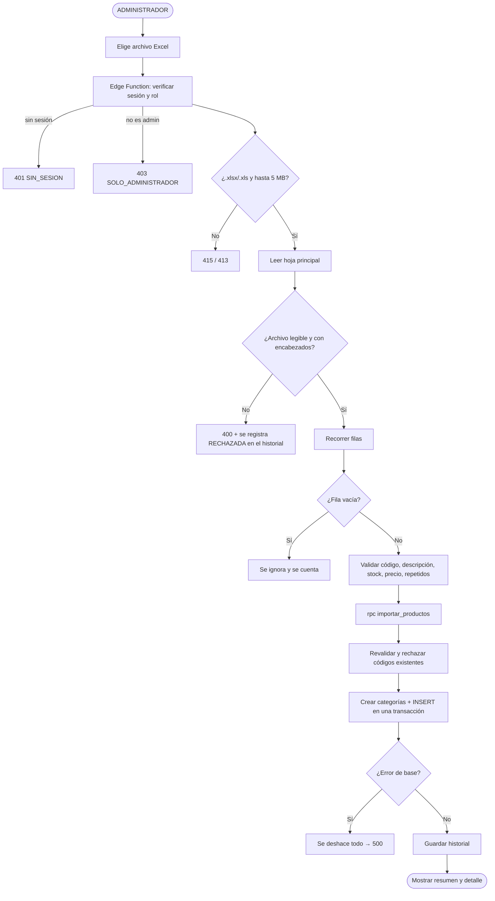
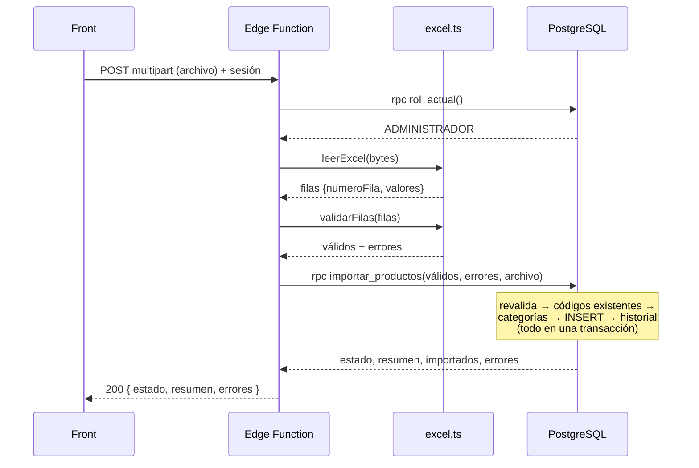

# Importar productos desde Excel

Funcionalidad para que un **ADMINISTRADOR** suba una planilla Excel y cada fila se convierta en un
producto de la base de stock, con validación previa, resumen del proceso y detalle de los errores.

Todo corre en **Supabase**, sin servidor aparte:

| | |
|---|---|
| **Edge Function** | `supabase/functions/importar-productos/` (`index.ts` + `excel.ts`) |
| **Función SQL** | `importar_productos`, migración `20261111193423_importar_productos.sql` |
| **Historial** | Tablas `importacion_producto` e `importacion_producto_error`, migración `20261111120000_importacion_productos.sql` |
| **Pruebas** | 45 por la API: `bash supabase/pruebas/prueba_importacion.sh` |
| **Pantalla de ejemplo** | [`ImportarProductos.jsx`](ImportarProductos.jsx) |
| **Planillas de ejemplo** | [`ejemplos/productos-ejemplo.xlsx`](ejemplos/productos-ejemplo.xlsx) y [`ejemplos/productos-con-errores.xlsx`](ejemplos/productos-con-errores.xlsx) (se regeneran con `npm run generar-ejemplos`) |

> **No se cambió ninguna regla existente:** ni RLS, ni `registrar_movimiento`, ni la forma de crear
> productos. La importación usa esas reglas y solo suma archivos nuevos.

---

## Índice

1. [Arquitectura](#1-arquitectura)
2. [Modelo de datos](#2-modelo-de-datos)
3. [Componentes](#3-componentes)
4. [Casos de uso](#4-casos-de-uso)
5. [Diagrama de flujo](#5-diagrama-de-flujo)
6. [Diseño de la interfaz](#6-diseño-de-la-interfaz)
7. [API](#7-api)
8. [Puesta en marcha](#8-puesta-en-marcha)
9. [Explicación paso a paso](#9-explicación-paso-a-paso)
10. [Validaciones y mensajes](#10-validaciones-y-mensajes)
11. [Pruebas](#11-pruebas)
12. [Decisiones de diseño y límites](#12-decisiones-de-diseño-y-límites)

---

## 1. Arquitectura

```
Front (React)
   │  supabase.functions.invoke('importar-productos', { body: FormData })   ← sesión del admin
   ▼
Edge Function importar-productos           (Deno, servidores de Supabase)
   │  index.ts  → verifica que sea ADMINISTRADOR activo, recibe el archivo
   │  excel.ts  → lee la hoja y valida cada fila (lógica pura, sin base ni red)
   │  rpc('importar_productos', { productos válidos, errores, datos del archivo })
   ▼
Función SQL importar_productos             (PostgreSQL)
      vuelve a validar, rechaza códigos repetidos o existentes, crea categorías,
      inserta en UNA transacción y guarda el historial
```

**Por qué en dos partes:** leer un Excel no se puede hacer en SQL, así que lo hace la Edge Function.
Insertar con garantías (transacción, unicidad, permisos) es trabajo de la base, así que lo hace
la función SQL. Cada parte se puede probar sola.

**Seguridad:** la Edge Function corre con la **sesión del usuario**, nunca con la clave secreta. La
base vuelve a verificar el rol y aplica todas sus reglas, aunque alguien llame a la función SQL
directamente.

---

## 2. Modelo de datos

### 2.1 Mapeo Excel → `producto`

| Codigo | Descripcion | Categoria | Stock | Precio |
|---|---|---|---|---|
| P001 | Teclado Logitech | Perifericos | 25 | 15000 |
| P002 | Mouse Genius | Perifericos | 40 | 8500 |

| Columna Excel | Campo en `producto` | Regla |
|---|---|---|
| `Codigo` | `codigo` | Obligatorio, único, de hasta 50 caracteres |
| `Descripcion` | `nombre` | Obligatorio, de hasta 150 caracteres. Es el nombre que se ve en la app |
| `Categoria` | `id_categoria` | Opcional. Se busca por nombre; si no existe, se crea |
| `Stock` | `stock_actual` | Entero, 0 o más. Es el **stock inicial** |
| `Precio` | `precio_venta` | Número mayor que 0, con 2 decimales |
| `Costo` (opcional) | `precio_costo` | 0 o más. Si no viene, 0 |
| `Detalle` (opcional) | `descripcion` | Texto largo |
| — | `stock_minimo`, `stock_maximo` | 0 (la app los edita después) |
| — | `activo` | `true` |
| — | `fecha_alta` | `now()` |

**¿Por qué `Descripcion` va a `nombre`?** Porque en el modelo real `nombre` es el campo obligatorio y
`descripcion` es opcional. El texto largo va en la columna `Detalle`.

### 2.2 Columnas aceptadas (alias)

Se comparan sin acentos, sin mayúsculas y sin signos. La primera coincidencia gana:

| Campo | Alias aceptados |
|---|---|
| Código | `codigo`, `cod`, `cod producto`, `codigo producto`, `codigo de producto`, `sku`, `cod articulo`, `codigo articulo` |
| Descripción | `nombre`, `descripcion`, `producto`, `nombre producto`, `descripcion producto`, `denominacion` |
| Detalle | `detalle`, `descripcion larga`, `descripcion detallada`, `observaciones`, `notas` |
| Categoría | `categoria`, `rubro`, `familia`, `grupo` |
| Stock | `stock`, `stock actual`, `cantidad`, `existencias`, `existencia`, `unidades`, `stock disponible` |
| Precio | `precio`, `precio venta`, `precio de venta`, `pvp`, `precio publico`, `precio unitario`, `importe` |
| Costo | `costo`, `precio costo`, `precio de costo`, `precio compra`, `precio de compra`, `costo unitario` |

La fila de encabezados se busca en las **primeras 15 filas**, así que puede haber títulos arriba.

### 2.3 Tablas de historial

```sql
importacion_producto
  id_importacion         bigint identity PK
  fecha                  timestamptz  default now()
  id_usuario             uuid FK usuario (on delete set null)
  archivo, hoja          text
  tamano_bytes           bigint
  filas_procesadas       integer   -- filas con datos (sin contar vacías)
  filas_vacias           integer
  productos_importados   integer
  filas_con_error        integer
  errores_encontrados    integer
  estado                 text: COMPLETADA | COMPLETADA_CON_ERRORES | RECHAZADA | FALLIDA
  duracion_ms            integer
  detalle                jsonb     -- hojas, fila del encabezado, columnas ignoradas, categorías nuevas

importacion_producto_error
  id_error        bigint identity PK
  id_importacion  bigint FK importacion_producto (on delete cascade)
  numero_fila     integer
  codigo          text
  mensaje         text
```

**RLS:** el ADMINISTRADOR puede leerlas, y nadie puede escribirlas desde el front. Solo escribe la
función `importar_productos`, que es `security definer` y valida el rol.

---

## 3. Componentes

| Archivo | Responsabilidad |
|---|---|
| `functions/importar-productos/index.ts` | HTTP: CORS, verificar que sea admin (`rpc('rol_actual')` con la sesión del usuario), recibir el archivo (multipart, hasta 5 MB, `.xlsx`/`.xls`), devolver la plantilla por GET, llamar a la función SQL y armar la respuesta |
| `functions/importar-productos/excel.ts` | Lógica pura: verificar la firma real del archivo, leer la hoja con SheetJS, ubicar el encabezado, mapear los alias, ignorar filas vacías, interpretar números (`15.000`, `$ 1.500,50`), validar cada fila y detectar repetidos. También genera la plantilla |
| `migrations/..._importar_productos.sql` | `importar_productos(...)`: verificar el rol, revalidar, rechazar códigos existentes sin distinguir mayúsculas, crear categorías, insertar en una transacción con `ON CONFLICT DO NOTHING` y guardar el historial |
| `migrations/..._importacion_productos.sql` | Tablas de historial con RLS |

---

## 4. Casos de uso

Actor principal: **ADMINISTRADOR** con sesión iniciada.

### CU-01 · Importar productos desde una planilla válida
| | |
|---|---|
| **Precondición** | Sesión iniciada con rol ADMINISTRADOR activo. Planilla con las columnas obligatorias |
| **Disparador** | El usuario elige "Importar desde Excel", selecciona el archivo y confirma |
| **Flujo principal** | 1. Se verifica la sesión y el rol. 2. Se recibe el archivo (hasta 5 MB, `.xlsx`/`.xls`). 3. Se lee la hoja principal. 4. Se validan las filas. 5. Se descartan las vacías. 6. Se insertan las válidas en una transacción. 7. Se muestra el resumen: procesados, importados, con error y el detalle |
| **Postcondición** | Productos creados con su stock inicial, `activo = true` y categoría asignada. Resumen guardado en el historial |

### CU-02 · Importar una planilla con filas inválidas
Igual que CU-01, pero las filas con error **no** se importan. El resumen indica cuántas se
procesaron, cuántas entraron y el detalle por fila (`fila 3 — P002 — El stock no puede ser negativo`).
Estado: `COMPLETADA_CON_ERRORES`.

### CU-03 · Detectar un código repetido en el mismo Excel
La **primera** aparición es la válida; las siguientes se rechazan con
`El código "P005" está repetido en el archivo (ya aparece en la fila 7).`

### CU-04 · Rechazar códigos que ya existen en el sistema
`El código "P001" ya existe en el sistema.` No distingue mayúsculas: `p001` es lo mismo que `P001`.

### CU-05 · Descargar la plantilla
Un GET a la Edge Function devuelve `plantilla-productos.xlsx`, con las columnas correctas y dos filas de ejemplo.

### CU-06 · Consultar el historial
El admin lee `importacion_producto` (y el detalle en `importacion_producto_error`) con
`supabase.from(...)`. Los archivos rechazados también quedan registrados.

### CU-07 · Archivo inválido
Si el archivo no es Excel, supera el tamaño, no tiene encabezados o le faltan columnas, **no se carga
ningún producto** y se responde con un mensaje que dice qué corregir.

### Errores contemplados
| Situación | Resultado |
|---|---|
| Sin sesión o con la sesión vencida | 401 `SIN_SESION` |
| EMPLEADO o usuario inactivo | 403 `SOLO_ADMINISTRADOR` |
| Archivo `.csv` u otro tipo | 415 `TIPO_NO_PERMITIDO` |
| Texto disfrazado de `.xlsx` o archivo dañado | 400 `ARCHIVO_ILEGIBLE` |
| Archivo de más de 5 MB | 413 `ARCHIVO_MUY_GRANDE` |
| Faltan columnas | 400 `COLUMNAS_FALTANTES`, con la lista |
| Más de 2.000 filas | 400 `DEMASIADAS_FILAS` |
| Falla la base a mitad de la inserción | Se deshace todo (transacción): 500 `ERROR_BASE_DE_DATOS` |

---

## 5. Diagrama de flujo





---

## 6. Diseño de la interfaz

Pantalla dentro de **Inventario → Productos → "Importar desde Excel"**, con la estética del front
actual: tarjetas blancas, texto `#434655`, acento `#dce9ff` e iconos `lucide-react`.

### 6.1 Wireframe
```
┌──────────────────────────────────────────────────────────────────────────┐
│  ← Productos                Importar productos desde Excel               │
│                             Cargá la planilla y revisá el resultado       │
├──────────────────────────────────────────────────────────────────────────┤
│  ┌────────────────────────────────────────────────────────────────────┐  │
│  │                              ⬆                                     │  │
│  │              Arrastrá tu planilla acá o elegí un archivo            │  │
│  │                     .xlsx o .xls · hasta 5 MB                       │  │
│  │        [ Elegir archivo ]        [ Descargar plantilla ]           │  │
│  └────────────────────────────────────────────────────────────────────┘  │
│  ┌──────────────────────┐ ┌──────────────────────┐ ┌──────────────────┐  │
│  │  📄  9               │ │  ✅  2               │ │  ⚠️  7           │  │
│  │  Registros procesados│ │  Productos importados│ │  Con error       │  │
│  └──────────────────────┘ └──────────────────────┘ └──────────────────┘  │
│  ┌────────────────────────────────────────────────────────────────────┐  │
│  │  Detalle de errores                              [Filtro: todas ▾] │  │
│  ├──────┬────────┬───────────────────────────────────────────────────┤  │
│  │ Fila │ Código │ Problema                                          │  │
│  │  3   │ P002   │ El stock no puede ser negativo.                   │  │
│  │  4   │ P003   │ El precio tiene que ser mayor que cero.           │  │
│  │  8   │ P005   │ El código "P005" está repetido (fila 7).          │  │
│  └──────┴────────┴───────────────────────────────────────────────────┘  │
│         [ Volver a importar ]                    [ Ver productos ]       │
└──────────────────────────────────────────────────────────────────────────┘
```

### 6.2 Estados de la pantalla
| Estado | Qué ve el usuario |
|---|---|
| **Inicial** | Zona para arrastrar el archivo, botón "Descargar plantilla" y requisitos |
| **Archivo elegido** | Nombre, tamaño, botón "Importar" habilitado y "Cambiar archivo" |
| **Procesando** | Spinner, con los botones deshabilitados |
| **Resultado OK** | Tres tarjetas (procesados / importados / con error) y "Se importaron N productos" |
| **Resultado con errores** | Las tres tarjetas y la tabla de errores por fila |
| **Todo rechazado** (`estado: RECHAZADA`) | Aviso "No se importó ningún producto" y "Volver a importar" |
| **Error de archivo** | El mensaje que manda el backend, por ejemplo "Falta la columna Precio" |

Reglas de UX:
- Deshabilitar el botón mientras se procesa, para evitar el doble envío.
- Mostrar los mensajes **tal como vienen**: ya están en español.
- Después de importar, refrescar la lista de productos y los KPIs.
- Mostrar la opción solo al ADMINISTRADOR (`rpc('rol_actual')`). Igual, la base no deja importar a un empleado.

### 6.3 Componente de referencia
[`ImportarProductos.jsx`](ImportarProductos.jsx) es una implementación completa (drag & drop, estados
y tabla de errores) lista para copiar al front. Usa `VITE_SUPABASE_URL` y `VITE_SUPABASE_ANON_KEY`, y
recibe el token de la sesión por prop:
```jsx
<ImportarProductos token={session.access_token} onImportado={refrescarProductos} />
```

---

## 7. API

### Importar: `POST /functions/v1/importar-productos`
```js
const datos = new FormData()
datos.append('archivo', archivo)        // obligatorio
datos.append('hoja', 'Productos')       // opcional: por defecto, la primera hoja
const { data, error } = await supabase.functions.invoke('importar-productos', { body: datos })
if (error) {
  const cuerpo = await error.context.json()   // { ok:false, error:{ codigo, mensaje, detalles } }
}
```

**Respuesta 200:**
```json
{
  "ok": true,
  "estado": "COMPLETADA_CON_ERRORES",
  "idImportacion": 12,
  "archivo": { "nombre": "productos.xlsx", "tamanoBytes": 9123, "hoja": "Productos",
               "hojas": ["Productos"], "filaEncabezado": 1, "columnasIgnoradas": [] },
  "fecha": "2026-11-11T19:40:00.000Z",
  "duracionMs": 84,
  "resumen": { "registrosProcesados": 9, "productosImportados": 2, "registrosConError": 7,
               "erroresEncontrados": 7, "filasVacias": 1, "categoriasNuevas": ["Audio", "Perifericos"] },
  "importados": [{ "fila": 2, "codigo": "P001", "idProducto": 31 }],
  "errores": [{ "fila": 3, "codigo": "P002", "campo": "stock", "mensaje": "El stock no puede ser negativo." }]
}
```
`estado`: `COMPLETADA` (todo entró), `COMPLETADA_CON_ERRORES` (entraron algunos) o `RECHAZADA` (no entró ninguno).

**Respuesta de error (4xx/5xx):**
```json
{ "ok": false, "idImportacion": 13,
  "error": { "codigo": "COLUMNAS_FALTANTES", "mensaje": "A la planilla le falta la columna: Precio.",
             "detalles": { "faltantes": ["Precio"], "encontradas": ["Codigo", "Descripcion", "Stock"] } } }
```

### Plantilla: `GET /functions/v1/importar-productos`
Devuelve `plantilla-productos.xlsx`. También exige sesión de admin.

### Historial (directo a la base)
```js
const { data } = await supabase
  .from('importacion_producto')
  .select('id_importacion, fecha, archivo, estado, filas_procesadas, productos_importados, filas_con_error, usuario(nombre, apellido)')
  .order('fecha', { ascending: false })
  .limit(10)
```

---

## 8. Puesta en marcha

En la carpeta `gestor-stock-server`:
```bash
npx supabase db push                               # 2 migraciones: historial y función importar_productos
npx supabase functions deploy importar-productos   # publica la Edge Function
```
No hace falta configurar nada más: la Edge Function usa `SUPABASE_URL` y `SUPABASE_ANON_KEY`, que
Supabase ya le provee.

---

## 9. Explicación paso a paso

1. **El admin elige el archivo.** El front lo manda como `FormData` a la Edge Function, con la sesión.
2. **¿Quién es?** La Edge Function crea un cliente de Supabase **con el token del usuario** y llama a
   `rol_actual()`. Si no es ADMINISTRADOR activo, corta con 401/403 sin leer el archivo.
3. **¿Es un Excel?** Se revisan la extensión, el tamaño (hasta 5 MB) y la **firma real** de los bytes,
   para que un `.txt` renombrado no pase.
4. **Lectura.** SheetJS abre la primera hoja, o la pedida. Se busca la fila de encabezados entre las
   primeras 15, se reconocen las columnas por sus alias y se ignoran las filas vacías.
5. **Validación de cada fila.** Código, descripción, stock (entero, 0 o más) y precio (mayor que 0). Los
   números se interpretan como los escribe la gente (`15.000`, `$ 1.500,50`) y se detectan los
   códigos repetidos dentro del Excel.
6. **A la base.** Se llama a `importar_productos` con los productos válidos y los errores encontrados.
7. **En la base**, todo dentro de **una transacción**:
   1. se vuelve a verificar el rol y a validar cada producto;
   2. se rechazan los códigos que ya existen, sin distinguir mayúsculas;
   3. se crean las categorías que faltan;
   4. se insertan los productos (si otro los creó en ese instante, se informan como error y no se rompe nada);
   5. se guarda el historial con el detalle de errores.
8. **Respuesta.** La Edge Function devuelve el resumen, que el front muestra tal cual.
9. **Si el archivo no se pudo leer**, igual queda en el historial como `RECHAZADA`, con el motivo.

---

## 10. Validaciones y mensajes

| Regla | Mensaje |
|---|---|
| Código obligatorio | `El código es obligatorio.` |
| Código de hasta 50 caracteres | `El código no puede superar los 50 caracteres (tiene 51).` |
| Código único en el archivo | `El código "P005" está repetido en el archivo (ya aparece en la fila 7).` |
| Código único en el sistema | `El código "P001" ya existe en el sistema.` |
| Descripción obligatoria | `La descripción es obligatoria.` |
| Descripción de hasta 150 caracteres | `La descripción no puede superar los 150 caracteres (tiene 151).` |
| Stock vacío | `El stock es obligatorio (0 o más).` |
| Stock no numérico | `El stock tiene que ser un número entero. Valor recibido: mucho.` |
| Stock con decimales | `El stock tiene que ser un número entero, sin decimales. Valor recibido: 2.5.` |
| Stock negativo | `El stock no puede ser negativo.` |
| Precio vacío | `El precio es obligatorio.` |
| Precio de 0 o menos | `El precio tiene que ser mayor que cero.` |
| Precio no numérico | `El precio tiene que ser un número. Valor recibido: consultar.` |
| Costo negativo | `El costo no puede ser negativo.` |
| Categoría de más de 100 caracteres | `La categoría no puede superar los 100 caracteres (tiene 120).` |
| Fila vacía | No es error: se ignora y se informa en `filasVacias`. |

---

## 11. Pruebas

Contra la base local (Docker), igual que las usa el front:
```bash
npx supabase start -x realtime,storage-api,imgproxy,mailpit,studio,logflare,vector,supavisor,postgres-meta
npx supabase db reset --local --no-seed
docker exec -i supabase_db_gestor-stock-server psql -U postgres -d postgres < supabase/pruebas/datos_demo.sql
npm install
bash supabase/pruebas/prueba_importacion.sh
```

**45 pruebas, 45 OK (11/11/2026):**

| Grupo | Qué se verificó |
|---|---|
| Permisos | Sin sesión → 401. Un EMPLEADO → 403, también si llama a la función SQL directo. El admin descarga la plantilla |
| Planilla con errores | 9 procesados, 2 importados, 7 errores con su fila y motivo, 1 fila vacía ignorada |
| Planilla de ejemplo | 6 importados, 2 que ya existían y 4 categorías nuevas. El producto queda bien guardado. Importarla de nuevo → `RECHAZADA` |
| Formatos | Título arriba del encabezado, alias (SKU, PVP, Rubro), `15.000`, `$ 1.500,50`, categoría existente sin importar acentos ni mayúsculas, espacios de más, archivo `.xls` |
| Archivos inválidos | Falta una columna (queda en el historial), texto disfrazado de `.xlsx`, `.csv`, sin archivo |
| Defensa en la base | Llamar a la función SQL directo con precio 0 o stock con decimales → rechazado |
| Historial | El admin lo ve con el detalle de errores; el empleado no |

---

## 12. Decisiones de diseño y límites

**Supabase y no un servidor aparte.** Todo el backend de StockFX está en Supabase. Un servidor
Express necesitaba publicarse en algún lado y guardar la contraseña de la base (`DATABASE_URL`). La Edge
Function corre en Supabase y usa la sesión del usuario.

**El stock inicial no genera movimiento.** Es la misma regla que al crear un producto a mano: el
stock se carga al crearlo y después solo cambia con `registrar_movimiento`.

**Importación atómica.** Los productos válidos entran todos en una transacción: si la base falla, no
queda media planilla cargada.

**`ON CONFLICT DO NOTHING`.** Si dos personas importan el mismo código al mismo tiempo, la segunda fila
se informa como error y la importación sigue.

**Códigos sin distinguir mayúsculas.** La base permite `P001` y `p001` a la vez, porque su `UNIQUE`
sí distingue mayúsculas, pero para el usuario son el mismo producto: la importación los trata como iguales.

**Límites.** 5 MB y 2.000 filas por archivo. La lectura se corta apenas pasa el máximo, para no cargar archivos enormes en memoria.

**SheetJS 0.20.3** desde su CDN oficial: la versión de npm (0.18.5) tiene fallas de seguridad conocidas.

**Lo que no hace.** No actualiza productos existentes (los informa como error), no borra nada, no
importa movimientos y no deja importar a un EMPLEADO.
